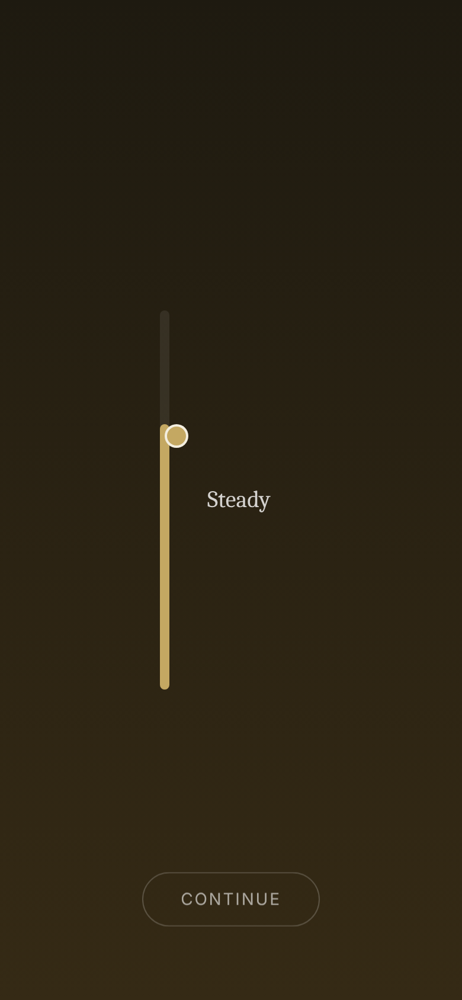
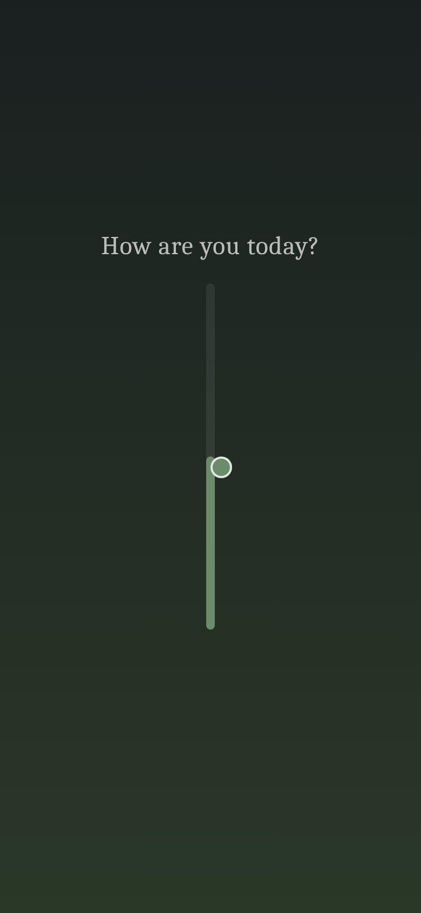
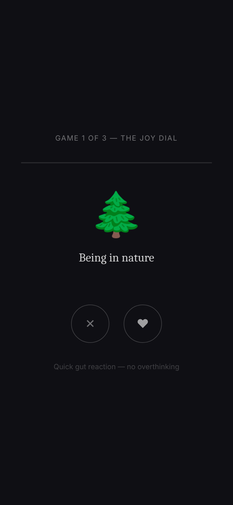

# An — Identity Anchor App

> *"You've been collecting yourself your whole life. We help you find it when you need it most."*

An is a self-peace app that holds everything you are — your past achievements, what genuinely restores you, what's weighing on you right now, and everything that ever made you more yourself — and delivers it back with precision when you're falling apart.

This is not a meditation app. Not a therapy app. Not a journaling app.  
It is a **living identity mirror**, built in your best moments, and available in your worst.

---

## Screenshots

| Mood Bar | Mood Jar | Intent Screen |
|---|---|---|
|  |  |  |

| Treasury | Identity Vault | Living Journal |
|---|---|---|
|  |  |  |

---

## MVP Features (V1)

### Mood Bar
Every session opens with a gestural vertical slider. 8 mood words — Heavy, Low, Quiet, Okay, Steady, Good, Light, Bright — are visible along the scale before you touch it. The active word highlights; the background shifts in sync. No numbers ever.

### Mood Jar
After setting your mood, today's answer drops as a glowing colored ball into a mason jar. The jar collects every mood for the current month. Watch the month fill.

### Intent Screen
Four cards: **Anchor myself** · **Light myself up** · **Random thoughts** · **My Treasury**. What do you need right now?

### Identity Vault
14 fill-in-the-blank templates across 6 categories — Family, Friends, Work & Craft, Character, World, Achievements. Tap a template, pick word chips, see your sentence build live. Each entry becomes a quoted card in your vault.

> *"I am loyal, present to my family."*  
> *"My friends come to me when they need someone to listen."*  
> *"When things get hard, I am resilient."*

### Treasury
An enchanted tree in the dark. Each artifact you add becomes a glowing colored leaf — gold for Words, green for Places, blue for People, pink for Ideas. Starter templates remove blank-page paralysis:
- *"When I was young, my ___ told me that ___."*
- *"Someone once told me I was ___, and they were right."*

Browse all, tap any leaf to read it full screen, or Shuffle for a random artifact.

### Living Journal
A raw, unstructured space. No structure unless you want it. Optional prompts on demand. Emotional tags. Entries display in a chronological feed.

### Anchor Now
One tap from any screen. 5-step crisis flow: situation read → Treasury artifact → Identity Vault anchor → grounding steps → close. Everything drawn from your own vault.

---

## Tech Stack

- **React + TypeScript + Vite**
- **TailwindCSS** — dark atmospheric design
- **Framer Motion** — organic animations throughout
- **Zustand** — state management, persisted to localStorage
- **React Router v6**

---

## Run Locally

```bash
git clone https://github.com/yiluo829pro/An.git
cd An
npm install
npm run dev
```

Open `http://localhost:5173`

---

## Roadmap

**V2 (next)**
- Struggle Map — real-time context of what's weighing on you
- Vision Vault — your ideal self, held visually
- Joy Map — find what fills you right now
- Received Wisdom — capture what others tell you

**V3**
- Identity Turbulence Visualizer — weather map of your transition journey
- Mood History calendar view
- Time Capsule delivery
- Wearable integration

---

*Built with [Claude Code](https://claude.com/claude-code)*
